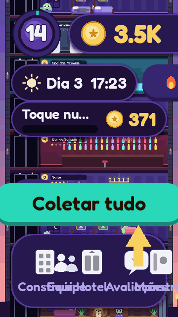
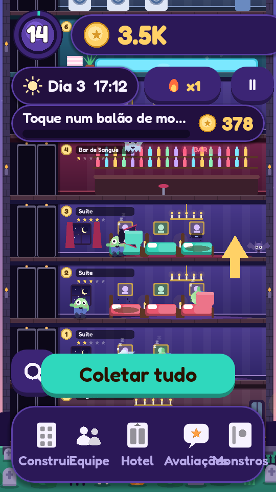
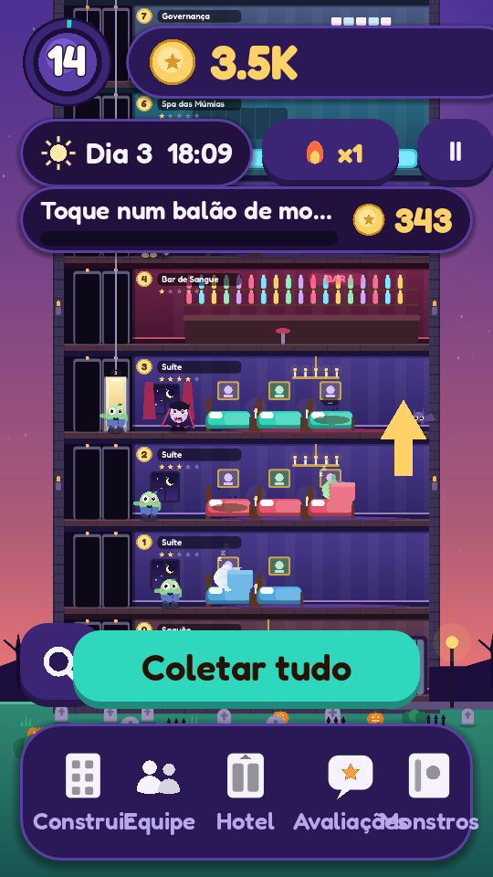
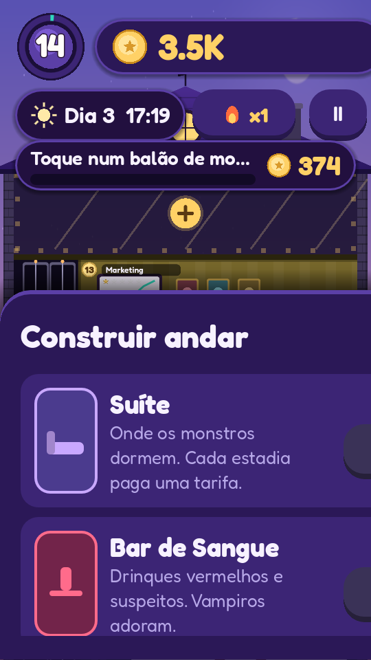
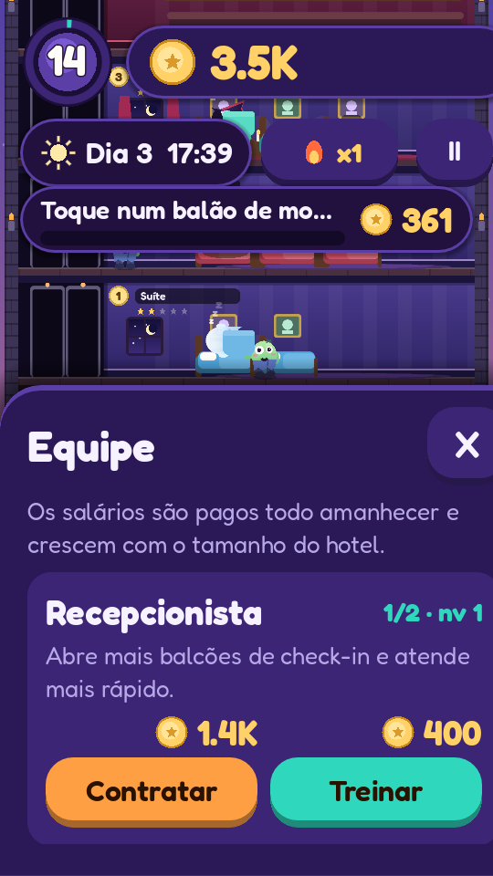
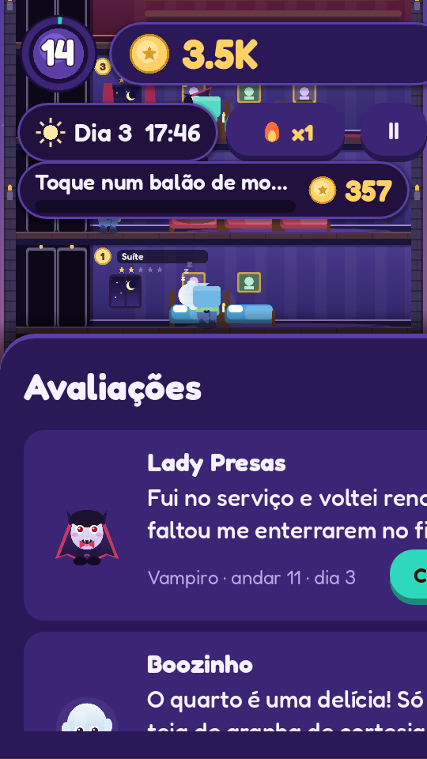
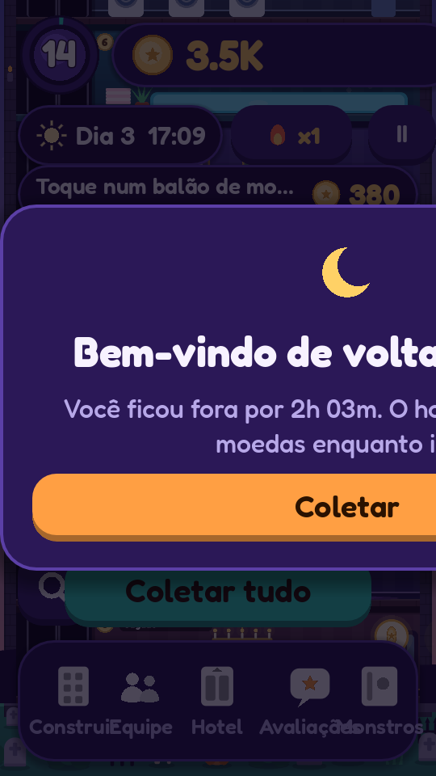
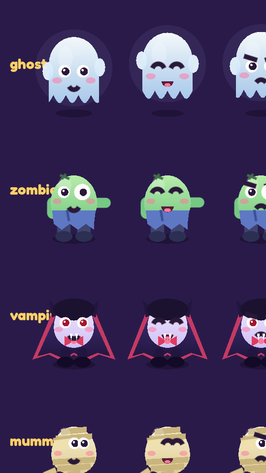

# 🏨 MONSTEL

> *Gerencie o hotel mais assombrosamente fofo do mundo!*

<div align="center">

[](https://godotengine.org/)
[](https://docs.godotengine.org/)
[]()
[](LICENSE)
[]()

<br/>



<p><em>Simulação viva da torre em tempo real: hóspedes monstrinhos, elevadores SCAN e automação</em></p>

</div>

---

**Monstel** é um jogo mobile de simulação e gerenciamento econômico (não é roguelite) desenvolvido em **Godot 4.7.2** com GDScript tipado, 2D vertical (modo retrato 1080×1920) e renderizador *Compatibility*.

A visão é em corte transversal da torre do hotel — como um formigueiro habitado por monstrinhos adoráveis. Você acompanha cada hóspede chegando à recepção, pegando o elevador, descansando nas suítes, curtindo as facilidades (bar, buffet, spa) e fazendo check-out. Cada hóspede deixa uma avaliação bem-humorada sobre a estadia, influenciando sua reputação de estrelas.

O jogo é **100% offline**, sem anúncios, sem compras no aplicativo (IAP) e com save atômico seguro.

---

## 📸 Capturas de Tela

<div align="center">
  <table>
    <tr>
      <th align="center">Torre do Hotel</th>
      <th align="center">Visão Geral (Zoom Out)</th>
      <th align="center">Construção & Expansão</th>
    </tr>
    <tr>
      <td></td>
      <td></td>
      <td></td>
    </tr>
    <tr>
      <th align="center">Gerenciamento de Equipe</th>
      <th align="center">Avaliações dos Hóspedes</th>
      <th align="center">Renda Offline</th>
    </tr>
    <tr>
      <td></td>
      <td></td>
      <td></td>
    </tr>
  </table>
</div>

---

## 🎮 Como Jogar

1. **Coletar Moedas:** Toque nos balões de moedas sobre os andares ou contrate um **Caixa** para automação total (com botão "Coletar Tudo").
2. **Construção & Expansão:** Use moedas para construir andares de **Suítes** (Padrão, Temática, Cripta Luxo) e **Facilidades** (Bar, Buffet, Spa). Toque em qualquer andar para melhorar seu nível.
3. **Gerenciar Equipe & Elevador (Aba Hotel):** Contrate e melhore colaboradores (Caixa, Faxineiro, Recepcionista, Mecânico, Garçom) e amplie a capacidade/velocidade dos elevadores.
4. **Reputação (★):** Gerada pelas avaliações dos hóspedes. Mais estrelas atraem mais clientes e rendem maiores gorjetas. Fila na recepção, elevador lotado, quarto sujo ou preços abusivos derrubam a nota!
5. **Políticas de Preço:** Ajuste a política de preços entre *Barato*, *Justo* ou *Luxo* para equilibrar lotação e margem de lucro.
6. **Metas & Progressão:** 35 metas guiam sua jornada, premiando moedas e cargas de **Hora do Rush** (60 segundos com 2,5× mais hóspedes).
7. **Eventos Especiais:**
   - **Hóspede VIP:** Toque nele para interagir e receber um bônus especial.
   - **Inspetor Secreto:** Faça bonito para garantir notas máximas.
   - **Hora do Rush:** Ative o pico de movimento para lucros rápidos.
8. **Monstros (6 Espécies):** Fantasmas, Zumbis, Vampiros, Múmias, Bruxas e Lobisomens — cada espécie possui manias, ritmos e preferências únicas.
9. **Avaliações & Modo Foto:** Leia os comentários absurdos deixados pelos hóspedes (com botão para copiar/compartilhar) e use o Modo Foto nas configurações para registrar sua torre.
10. **Renda Offline & Recompensa Diária:** Renda passiva de até **8 horas a 50% de eficiência** enquanto estiver fora do jogo e bônus diário cumulativo com streak. Não há game over: má gestão apenas desacelera o progresso.

<div align="center">
  
  <p><em>Galeria de espécies e expressões faciais (desenhadas 100% por código vetorial)</em></p>
</div>

### Controles
* **Arrastar com dedo / botão esquerdo do mouse:** Rola a torre verticalmente.
* **Pinça no celular / Roda do mouse:** Ajusta o nível de zoom.
* **Botão da Lupa:** Alterna rapidamente entre "Torre Inteira" e zoom detalhado.
* **Toque no Andar:** Abre a folha de detalhes e melhorias daquele andar.
* **Velocidade:** Botões de Pausa (⏸️), 1×, 2× e 4×.
* **Android:** Botão físico/virtual "Voltar" fecha janelas ativas, retorna ao menu e confirma saída do app.

---

## 🚀 Como Executar no Computador

### Pré-requisitos
* [Godot Engine 4.7.2](https://godotengine.org/download) (versão padrão, sem .NET necessária).

### Clonando o Repositório
```bash
git clone https://github.com/<seu-usuario>/Monstel.git
cd Monstel
```

### Execução Rápida
* **Jogar direto:** Dê dois cliques em **`Jogar.bat`** (roda o jogo na resolução de celular 540×960 no PC, sem necessidade de exportar).
* **Abrir no Editor:** Dê dois cliques em **`Abrir-no-Editor.bat`** para carregar o projeto dentro do editor do Godot.
* **Via Linha de Comando:**
  ```cmd
  tools\dev.bat run
  ```

> *Dica:* Os scripts `.bat` procuram automaticamente o Godot no caminho padrão ou no seu `PATH`. Se preferir definir manualmente, configure a variável de ambiente `GODOT_EXE` apontando para o binário do Godot.

---

## 📱 Gerando o APK para Celular (Android)

Para gerar o pacote Android localmente:

1. **Configuração de Ambiente (uma única vez):**
   - **Export Templates:** Templates do Godot 4.7.2 instalados no editor.
   - **JDK:** OpenJDK 17 (ex: Eclipse Temurin).
   - **Android SDK:** Command-line Tools, Platform-tools e Build-tools (versão 35 recomendada).
   - Configurar os caminhos do SDK, JDK e Keystore de debug no Godot em: `Editor -> Editor Settings -> Export -> Android`.
   - *Nota:* NDK e CMake **não** são necessários (a exportação é feita sem compilação Gradle/GDExtension).

2. **Compilar o APK:**
   ```cmd
   tools\build_apk.bat
   ```
   O APK de debug será compilado em **`builds\Monstel-debug.apk`** (~28 MB, arquitetura `arm64-v8a`, permissão única: `VIBRATE`, Android 7.0+).

3. **Instalar no Dispositivo:**
   * **Por cabo USB:** Conecte o celular com a *Depuração USB* ativada e execute:
     ```cmd
     tools\install_apk.bat
     ```
   * **Sem cabo:** Copie o arquivo `builds\Monstel-debug.apk` para o celular e permita a instalação de aplicativos desconhecidos.

---

## 🏗️ Arquitetura e Decisões Técnicas

* **Simulação Pura Desacoplada (`scripts/sim/`):** A lógica de negócios, hóspedes, elevadores (algoritmo SCAN), economia, reputação e eventos herda de `RefCounted`. Não há nós de cena ou dependências visuais. Isso permite simular dias de jogo em milissegundos sem janela gráfica e garante suporte robusto para cálculo da renda offline.
* **Arte Procedural por Código (`scripts/view/`):** Todo o visual dos monstros, andares e cenários é gerado por código via chamadas de vetor/`_draw`. Não há dependência de dezenas de megabytes de spritesheets. Um sistema de cache (`Baker`) pré-renderiza a arte estática em texturas em memória (atlas 2×), reduzindo o número de draw calls de mais de 2.000 para cerca de 400.
* **Áudio Sintetizado por Código:** Efeitos sonoros e trilha musical são gerados proceduralmente via GDScript (`tools/gen_audio.gd`), gerando arquivos WAV leves e sem dependências externas de áudio licenciado.
* **Persistência Atômica:** O estado do jogo mora no modelo `Hotel` e é serializado em JSON com salvamento atômico, backup de segurança e validação automática de dados corrompidos. Autosave a cada 15 segundos e ao pausar/sair.
* **Internacionalização Dinâmica:** Suporte completo para Português (PT) e Inglês (EN) através de `data/i18n.json` e `data/reviews.json`.

---

## 📂 Estrutura do Repositório

```
Monstel/
├── .gitignore              # Ignora .godot, builds, keystores, logs e temporários
├── .gitattributes         # Normalização de quebras de linha e arquivos binários
├── project.godot          # Arquivo mestre de configuração da engine Godot 4.7
├── export_presets.cfg     # Predefinições de exportação (Android / Windows)
├── Jogar.bat              # Atalho para executar o jogo diretamente no PC
├── Abrir-no-Editor.bat     # Atalho para abrir o projeto no Godot Editor
├── icon.svg               # Ícone do projeto
│
├── assets/                # Recursos de mídia estáticos
│   ├── audio/             # Efeitos sonoros e trilha sintetizados (.wav + .import)
│   ├── fonts/             # Fonte Fredoka (licença OFL)
│   └── icons/             # Ícones adaptativos do aplicativo Android
│
├── data/                  # Dados de conteúdo e texto do jogo
│   ├── i18n.json          # Textos de UI traduzidos (PT-BR e EN)
│   └── reviews.json       # Banco de textos e variações das avaliações dos hóspedes
│
├── scenes/                # Cenas principais do Godot
│   └── main.tscn          # Cena mestre do jogo
│
├── scripts/               # Código-fonte em GDScript
│   ├── autoload/          # Singletons globais (Loc, Sfx, Haptics, Save)
│   ├── data/              # Constantes de ritmo (balance.gd), quartos, espécies e metas
│   ├── game/              # Controlador de fluxo da cena principal e ciclo de vida
│   ├── sim/               # Modelos da simulação pura (Hotel, Guest, Elevator, Economy)
│   ├── ui/                # Componentes de interface, HUD, modais e folhas de painéis
│   ├── view/              # Renderização visual da torre, monstros e cenário
│   └── debug/             # Automação de capturas de tela e testes de integração
│
├── tests/                 # Testes automatizados e benchmarks
│   └── econ_sim.gd        # Bot headless de teste e calibração econômica
│
├── tools/                 # Scripts utilitários de suporte e automação
│   ├── dev.bat            # Atalhos de desenvolvimento (import, run, smoke, script)
│   ├── build_apk.bat      # Script para compilação headless do APK Android
│   ├── install_apk.bat    # Script para instalação e abertura via ADB no celular
│   ├── make_gif.js        # Compilador de frames em GIF animado otimizado
│   ├── gen_audio.gd       # Sintetizador procedural dos efeitos sonoros
│   └── gen_icons.gd       # Gerador procedural dos ícones Android
│
├── docs/                  # Documentação de design e capturas
│   ├── screenshots/       # GIF de gameplay e imagens de demonstração
│   └── PLANO.md           # Game Design Document (GDD) original aprovado
│
└── .claude/               # Referências de desenvolvimento e guias Godot
```

---

## 🧪 Testes Automatizados & QA

O repositório inclui suítes de validação que podem ser executadas sem interface gráfica ou em janelas automatizadas:

```cmd
:: Smoke test: valida compilação de scripts e recursos sem carregar janela
tools\dev.bat smoke

:: Simulação econômica acelerada (3 horas simuladas com política 'greedy'):
tools\dev.bat script res://tests/econ_sim.gd --hours=3 --policy=greedy --seed=2

:: Simulação econômica ociosa (sem compras, checa sustentabilidade financeira):
tools\dev.bat script res://tests/econ_sim.gd --hours=2 --policy=idle --seed=3

:: Reimportação de recursos e atualização de classes registradas:
tools\dev.bat import
```

### Resultados de Validação:
* **Simulação Econômica:** Testado por 12 horas consecutivas via bot — 0 hóspedes presos, 0 falhas ou dívidas insolúveis. Ritmo calibrado: 5 andares em ~9 min, 10 andares em ~41 min, 15 andares em ~2 h de jogo contínuo.
* **Persistência & Integridade:** 21/21 verificações de integridade de save, corrupção induzida e recuperação por backup passaram com sucesso.
* **Desempenho:** ~0,19 ms por passo de simulação em torre com 22 andares e 52 hóspedes ativos. Renderização a 60 FPS com ~400 draw calls em zoom padrão.

---

## ⚙️ Ajustes e Balanceamento

Se quiser calibrar ou modificar o jogo:
* **Economia e Ritmo:** Altere os parâmetros em [`scripts/data/balance.gd`](file:///scripts/data/balance.gd) (taxas de chegada, custos de construção, salários, multiplicadores de offline e eventos).
* **Novas Espécies e Quartos:** Adicione ou modifique registros em `scripts/data/species_db.gd` e `scripts/data/rooms_db.gd`.
* **Traduções e Diálogos:** Edite diretamente [`data/i18n.json`](file:///data/i18n.json) e [`data/reviews.json`](file:///data/reviews.json).
* **Nota importante sobre exportação:** Arquivos `.json` exigem inclusão explícita no filtro do Godot. O preset do projeto já contém `include_filter="data/*.json"`.

---

## 📄 Licença

Este projeto está sob licença aberta [MIT](file:///LICENSE). A fonte Fredoka é distribuída sob a [SIL Open Font License 1.1](file:///assets/fonts/OFL-Fredoka.txt).
